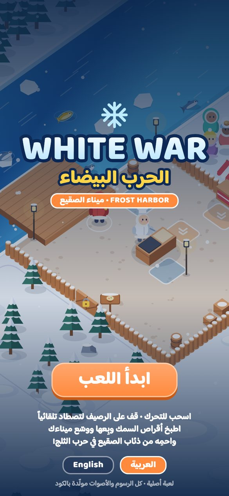
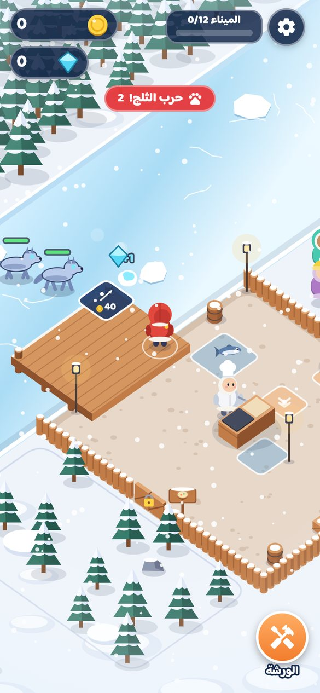
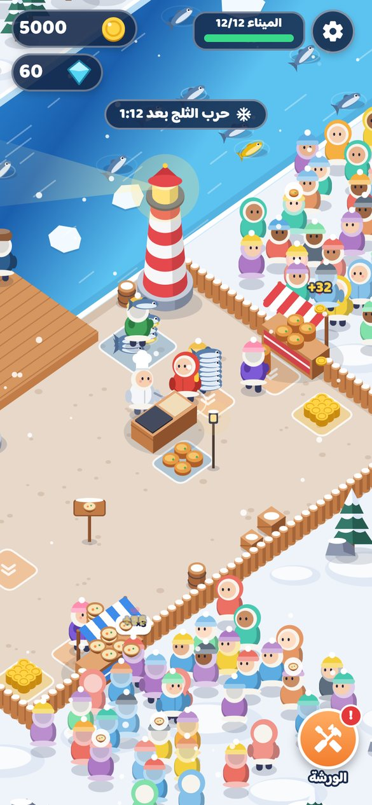
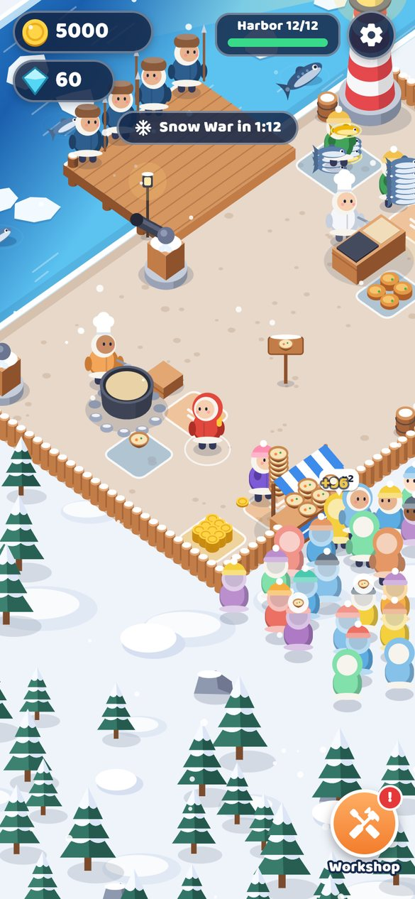

# ❄️ White War: Frost Harbor — الحرب البيضاء: ميناء الصقيع

**⬇️ تحميل نسخة أندرويد (APK) / Download the Android APK:**
**https://github.com/ahmedalgarbani/White_war/raw/main/releases/WhiteWar-v1.0.0.apk**

| | | | |
|---|---|---|---|
|  |  |  |  |

---

## 🇸🇦 بالعربية

لعبة **أصلية** مبنية بـ **Flutter** من نوع *Idle Arcade* (اجمع ← حضّر ← بِع ← وسّع)، بنفس روح أسلوب اللعب في الفيديو المرجعي لكن بهوية خاصة بها: شخصيات وعالم ورسوم وأصوات مولّدة كلها بالكود.

### فكرة اللعبة
أنت حارس **ميناء الصقيع** على ضفاف نهر جليدي:
1. **اصطد** – قف على الرصيف وسترمي الحِراب تلقائياً على الأسماك (السمك الذهبي والعملاق يعطيك بلورات).
2. **حضّر** – احمل السمك إلى طاولة الطاهي ليحوّله إلى **أقراص سمك**، ولاحقاً إلى **حساء السمك** في بيت الحساء.
3. **بِع** – ضع الأقراص على الكشك ليشتريها الزبائن الجائعون، ثم اجمع العملات.
4. **وسّع** – قف على المربعات المقفلة لتدفع وتفتح: صيادين، حمّالين، نُدُل، مدافع ثلج، بيت الحساء، و**منارة الشفق** (تضاعف أسعار البيع ×2).

### ✨ ما يميّزها: حرب الثلج
كل دقيقتين تقريباً **يتجمّد النهر** وتعبر **ذئاب الصقيع** فوق الجليد لسرقة السمك والطعام!
ترمي أنت والصيادون **كرات الثلج** تلقائياً، وتساعدكم **مدافع الثلج**. كل ذئب تهزمه يعطيك **بلورات صقيع** تُطوّر بها
قوة الرمي وسرعته وسعة الحمل وسرعة المشي وسرعة المطبخ من **الورشة**.

### التحكم
- اسحب بإصبعك في أي مكان على الشاشة لتحريك الشخصية (عصا تحكم عائمة).
- كل شيء آخر تلقائي: الصيد، الالتقاط، التسليم، الدفع، والقتال.
- سهم أصفر يرشدك للخطوة التالية في البداية.
- اللغة: العربية أو الإنجليزية (من الشاشة الرئيسية أو الإعدادات). التقدّم يُحفظ تلقائياً.

---

## 🇬🇧 English

An **original** idle-arcade game made with **Flutter**, built around the same *catch → process → sell → expand*
loop as the reference video but with its own identity. All characters, world art and sounds are generated in code.

**Loop:** stand on the dock to auto-harpoon fish → carry them to the chef who cooks **fish cakes** (later the cook
makes **chowder**) → stock the stall for the hungry crowd → collect coins → stand on unlock tiles to hire
harpooners, porters and waiters, build snow cannons, open the Chowder House and finally light the
**Aurora Lighthouse** (sale prices ×2).

**The twist — the Snow War:** every couple of minutes the river freezes and **frost wolves** cross the ice to steal
your food. You and your harpooners throw snowballs automatically and snow cannons join in. Defeated wolves drop
**frost crystals**, spent in the **Workshop** on throw power, throw speed, carry capacity, move speed and kitchen speed.

**Controls:** drag anywhere (floating joystick). Desktop/web: arrow keys or WASD. Everything else is automatic.

### Features
- Pseudo-3D isometric world drawn entirely with `CustomPainter` (no image assets): river, ice floes, forests,
  palisade, stalls, lighthouse, crowds, particles, snowfall, freezing river, wolves.
- 12 unlocks, 2 production chains, 5 upgrades × 8 levels, escalating raids with pack leaders.
- Arabic / English UI with the rounded *Baloo Bhaijaan 2* font, procedural music and sound effects, haptics.
- Auto-save (shared_preferences), works fully offline.

### Build it yourself
```bash
flutter pub get
flutter test                 # bot plays 30 simulated minutes and checks the whole progression
flutter build apk --release  # → build/app/outputs/flutter-apk/app-release.apk
```
Every push to `main` also builds the APK on GitHub Actions and publishes it as a release
(`.github/workflows/build-apk.yml`), so the newest build is always at
`https://github.com/ahmedalgarbani/White_war/releases/latest/download/white-war.apk`.

### Project layout
| Path | What |
|---|---|
| `lib/game/world.dart` | Game state & simulation (fish, stations, helpers, customers, raids, economy, save/load) |
| `lib/game/render.dart` | Isometric renderer (all drawing) |
| `lib/game/iso.dart` | Camera / projection |
| `lib/ui/` | Flutter UI: HUD, title screen, Workshop, settings |
| `tool/gen_audio.py`, `tool/gen_icon.py` | Generate the sounds/music and the app icon |
| `test/world_test.dart` | Headless simulation tests |

### Credits
Font: *Baloo Bhaijaan 2* by Ek Type — SIL Open Font License (`assets/fonts/OFL.txt`).
Everything else (art, music, sound) is original and generated by the scripts in this repository.
