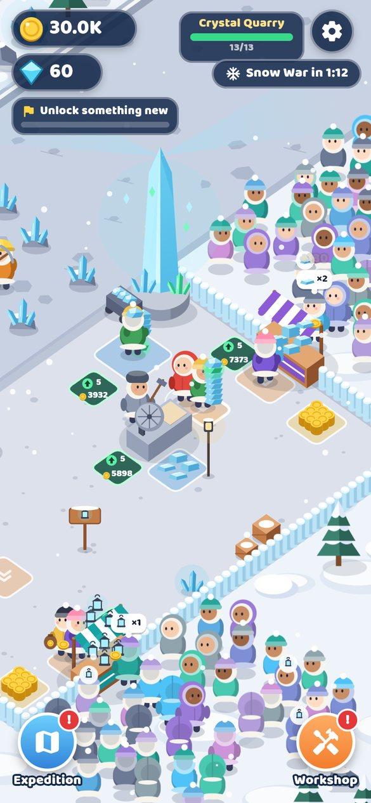
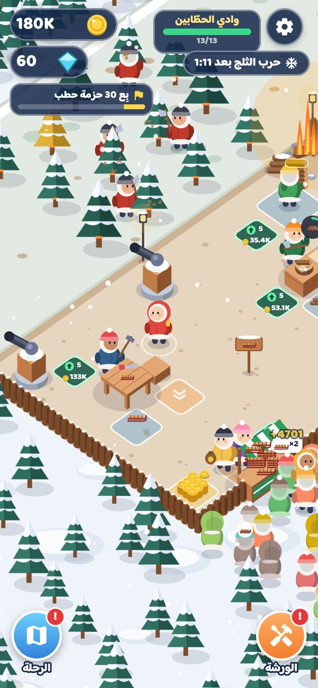
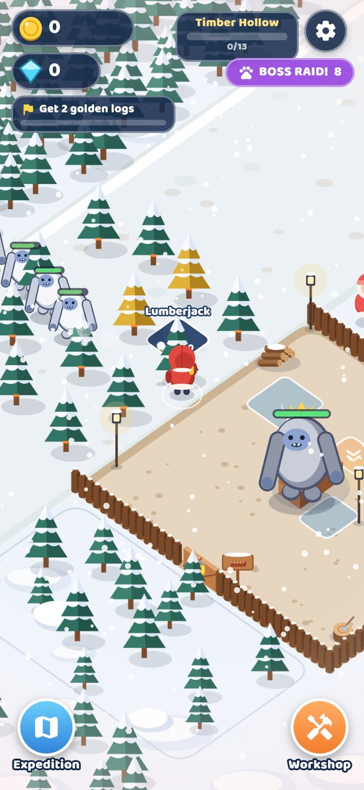
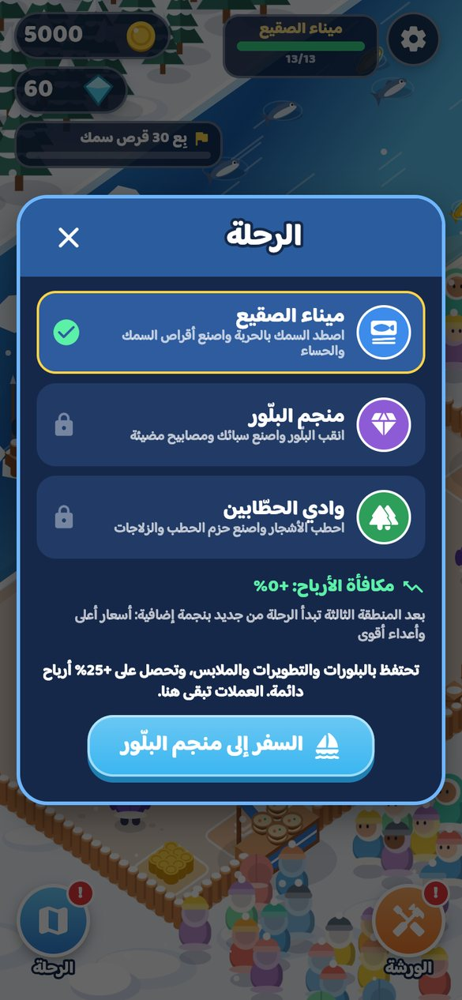

# ❄️ White War — الحرب البيضاء (v2: The Expedition)

**⬇️ تحميل نسخة أندرويد (APK) / Download the Android APK:**
**https://github.com/ahmedalgarbani/White_war/raw/main/releases/WhiteWar.apk**

| | | | |
|---|---|---|---|
|  |  |  |  |
|  |  |  |  |

---

## 🇸🇦 بالعربية

لعبة **أصلية** مبنية بـ **Flutter** من نوع *Idle Arcade* (اجمع ← اصنع ← بِع ← وسّع) بهوية خاصة بها:
كل الشخصيات والعالم والرسوم والأصوات مولّدة بالكود.

### 🗺️ رحلة من 3 مناطق — ولا تنتهي
| المنطقة | تجمع | تصنع وتبيع | أعداء حرب الثلج | المعلم الأخير |
|---|---|---|---|---|
| ❄️ ميناء الصقيع | تصطاد السمك بالحربة من الرصيف | أقراص السمك + حساء السمك | ذئاب الصقيع | منارة الشفق |
| 💎 منجم البلّور | تنقب البلّور بالفأس | سبائك البلّور + المصابيح المضيئة | عمالقة الجليد | برج البلّور |
| 🌲 وادي الحطّابين | تحطب الأشجار | حزم الحطب + الزلاجات | اليتي | الموقد العظيم |

- ابنِ المعلم الأخير لتفتح **السفر** إلى المنطقة التالية. تحتفظ بالبلورات والتطويرات والملابس وتحصل على **+25% أرباح دائمة** عن كل منطقة تكملها.
- بعد المنطقة الثالثة تبدأ الرحلة من جديد بـ **نجمة ★** إضافية: أسعار أكبر وأعداء أقوى — **بلا نهاية**.

### ✨ في كل منطقة
- **13 عنصراً للفتح**: جامعين (صيادين/منقبين/حطابين)، حمّالين، بائعين، **أمين صندوق** يجمع العملات عنك، مدافع ثلج، ورشة ثانية، والمعلم الأخير.
- **ترقية المحطات** حتى المستوى 10: المنصة، المطبخين، والكشكين (سرعة + سعة + أسعار أعلى).
- **حرب الثلج** كل دقيقتين تقريباً، و**هجوم زعيم 👑** كل رابع حرب.
- **3 مهام** دائماً بجوائز من العملات والبلورات.
- **الورشة**: 6 تطويرات × 10 مستويات (القوة، السرعة، الحمل، المشي، سرعة العمّال، زيادة الأرباح) + **خزانة ملابس** فيها 6 أزياء للبطل.
- **أرباح أثناء الغياب**: عمّالك يربحون لك وأنت خارج اللعبة (حتى ساعة).

### التحكم
اسحب في أي مكان للتحرك. الصيد والتنقيب والتحطيب والالتقاط والتسليم والدفع والقتال كلها تلقائية.
للدفع على المربعات قف عليها لحظة (المرور السريع لا يصرف عملاتك). التقدّم يُحفظ تلقائياً، واللغة عربي/إنجليزي.

---

## 🇬🇧 English

An **original** idle-arcade game made with **Flutter** (gather → craft → sell → expand) with its own identity —
every character, world, drawing and sound is generated in code.

### 🗺️ An endless 3-region expedition
| Region | Gather | Craft & sell | Snow War raiders | Final landmark |
|---|---|---|---|---|
| ❄️ Frost Harbor | harpoon fish from the dock | fish cakes + chowder | frost wolves | Aurora Lighthouse |
| 💎 Crystal Quarry | mine glowing crystals | crystal bars + crystal lamps | ice golems | Crystal Spire |
| 🌲 Timber Hollow | chop trees | firewood + sleds | yetis | Great Hearth |

Build a region's landmark to unlock **travel**. You keep crystals, workshop upgrades and outfits and earn a
**permanent +25% income** per completed region. After the third region the expedition loops with an extra **★ star**
(bigger prices, tougher raiders) — it never ends.

### Features
- 13 unlocks per region including gatherers, porters, sellers, a **Cashier** that banks coins for you, snow cannons,
  a second workshop and the landmark.
- **Station levels** up to Lv10 for the pad, both kitchens and both stalls (speed, capacity, better prices).
- **Snow War** raids every couple of minutes and a **boss raid 👑** every fourth war.
- **Quests** (3 at a time) with coin and crystal rewards; **Workshop** with 6 upgrades × 10 levels and a
  **Wardrobe** of 6 hero outfits; **offline earnings** (up to an hour).
- Pseudo-3D isometric world drawn with `CustomPainter` (static scenery cached into sprites), Arabic / English UI,
  procedural music and sound effects, haptics, auto-save (saves from v1 are migrated).

**Controls:** drag anywhere (floating joystick); desktop/web: arrow keys or WASD. Stand on a tile for a moment to pay.

### Build it yourself
```bash
flutter pub get
flutter test                 # a bot plays the whole 3-region expedition and checks pacing, saves, bosses...
flutter build apk --release  # → build/app/outputs/flutter-apk/app-release.apk
```
Every push to `main` also builds the APK on GitHub Actions and publishes it as a release
(`.github/workflows/build-apk.yml`): `https://github.com/ahmedalgarbani/White_war/releases/latest/download/white-war.apk`.
These CI builds are signed with the build machine's own debug key, so Android won't install one as an update over
`releases/WhiteWar.apk` (or the other way round) — pick one source and stick to it.

### Project layout
| Path | What |
|---|---|
| `lib/game/defs.dart` | Items, regions, looks, outfits, unlock paths, layout |
| `lib/game/world.dart` | Simulation: gathering, kitchens, helpers, customers, raids & bosses, quests, levels, travel, save/load |
| `lib/game/render.dart` | Isometric renderer (all drawing) |
| `lib/ui/` | HUD, title screen, Workshop & Wardrobe, Quests, Expedition map, settings |
| `tool/gen_audio.py`, `tool/gen_icon.py` | Generate the sounds/music and the app icon |
| `test/world_test.dart` | Headless simulation tests |

### Credits
Font: *Baloo Bhaijaan 2* by Ek Type — SIL Open Font License (`assets/fonts/OFL.txt`).
Everything else (art, music, sound) is original and generated by the scripts in this repository.
